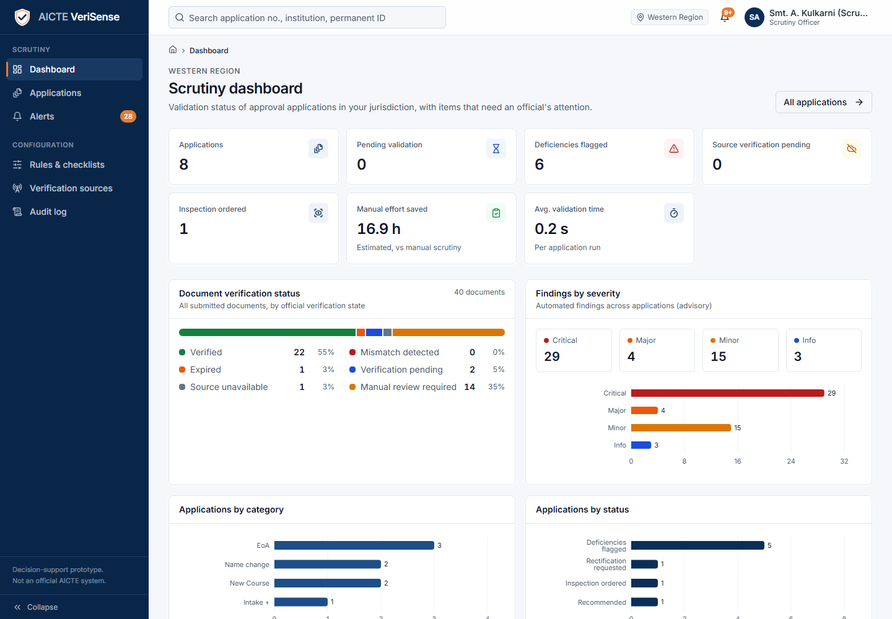
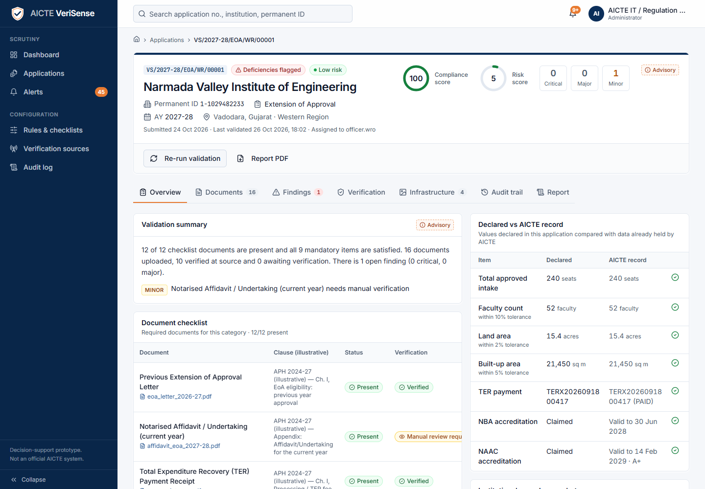
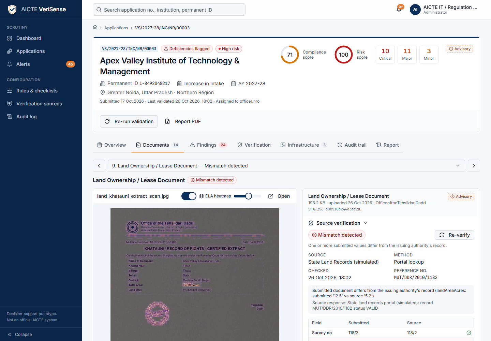
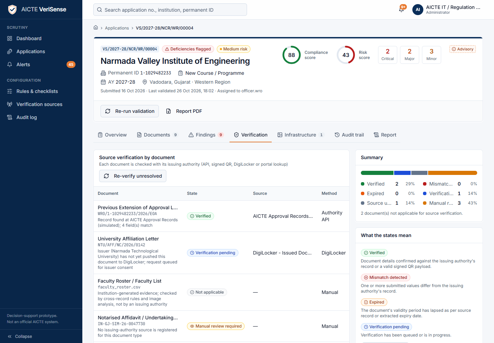
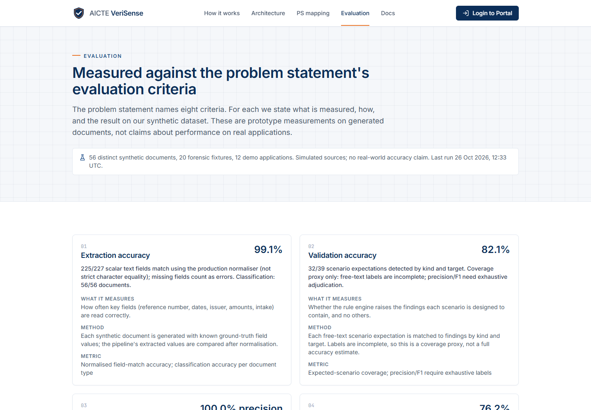
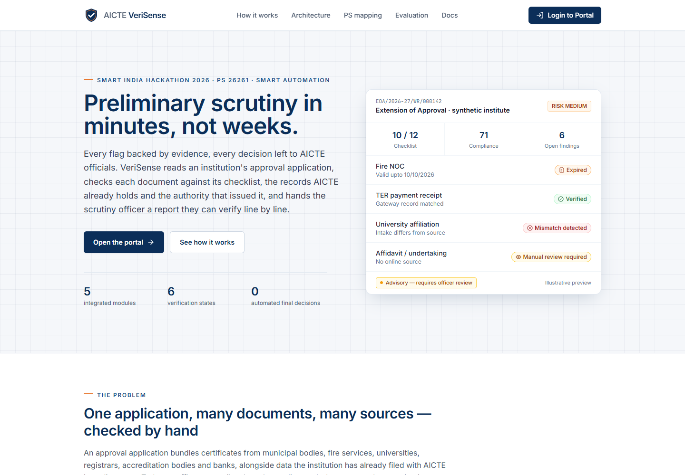
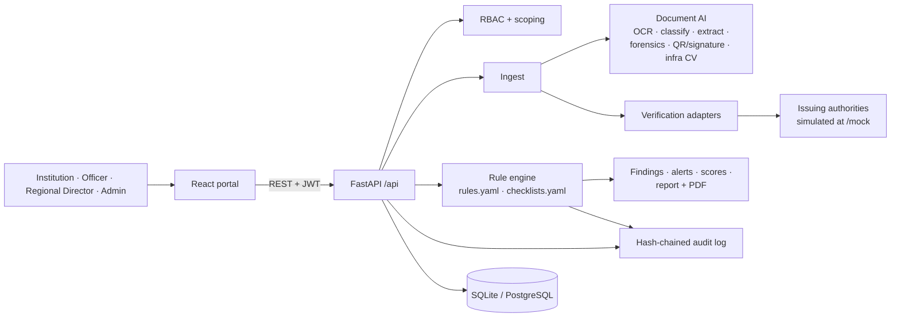

# AICTE VeriSense

> Integration hardening pass (27 October 2026): see [change summary](docs/CHANGE_SUMMARY.md),
> [120-requirement status](docs/MASTER_PROMPT_STATUS.md), [runbook](docs/RUNBOOK.md) and
> [release checklist](docs/RELEASE_CHECKLIST.md). Subsequent [local hosting verification](docs/LOCAL_HOSTING.md)
> installed portable runtimes: frontend lint/typecheck/build, 4 frontend tests, 67 backend tests,
> HTTP health checks and officer login now pass. Production/dependency/browser acceptance remains pending.
> Prior screenshots and benchmark metrics below are historical synthetic results. Unresolved critical
> findings block approval even when acknowledged or escalated; institutions cannot self-confirm resolution.

**Preliminary scrutiny in minutes, not weeks — every flag backed by evidence, every decision left to AICTE officials.**

VeriSense is a decision-support platform for the preliminary scrutiny of AICTE approval
applications. It identifies the applicable checklist, reads every uploaded document (OCR,
classification, field extraction), cross-checks it against records AICTE already holds and against
the authority that issued it, looks for signs of alteration or reuse, evaluates configurable norms
from the Approval Process Handbook, and gives scrutiny officers an explainable, evidence-linked
report. Final decisions remain with the competent authority.

> Smart India Hackathon 2026 · Problem Statement **26261** — *AI-Powered Application Validation,
> Document Authentication and Regulatory Compliance Verification* · AICTE, Regulation Bureau ·
> Theme: Smart Automation.
>
> This is a prototype. It is not an official AICTE system, and all institutions, people and
> documents in it are synthetic.

---

## Screenshots

Captured from a running local demo in Microsoft Edge. Full gallery: [`docs/images/`](docs/images/).

| Officer dashboard | Clean application — LOW risk |
|---|---|
|  |  |
| Evidence and ELA overlay | All six verification states |
|  |  |
| Measured evaluation | Public website |
|  |  |

## Demo readiness and measured results

- Clean NVIE renewal: **100 compliance, LOW risk**; new-course case: **MEDIUM risk**;
  planted Apex tampering remains **HIGH risk**. Risk indicators no longer accumulate without bounds.
- All **12 applications have documents**: six detailed scenarios and six supporting-document scenarios
  with intentionally incomplete category checklists. Seeding also backfills older demo databases.
- All six issuing-authority states occur, including a genuine simulated 503 response for the scanned State NOC.
- Synthetic evaluation: **99.1% normalised field accuracy (225/227)**, **56/56 document classifications**,
  **42/42 expected verification states**, and **5/5 source mismatches correctly flagged**.
- Forensic benchmark: **100% precision, 41.7% recall** on 20 fixtures (5 TP, 0 FP, 7 FN, 8 TN).
  This low recall is a known limitation, not production-grade authentication.
- Browser checks cover public pages, mobile evaluation layout, all seven tabs of all 12 applications,
  admin pages and the ELA switch. The walkthrough checks page errors and failed local requests.

Raw results: [`samples/evaluation.json`](samples/evaluation.json). Methodology, reproduction and
remaining work: [`docs/EVALUATION.md`](docs/EVALUATION.md).

## What it does

| Module | Highlights |
|---|---|
| **Application & document validation** | Category-specific checklists (7 categories, conditional items); institutional records pulled in (approvals, intake, faculty, accreditation, land, TER, deficiencies, affidavits); PDF text layer + RapidOCR; explainable classifier; per-type field extraction with source text and page; missing / expired / inconsistent items flagged; structured report and PDF |
| **Anomaly & potential-forgery detection** | Error Level Analysis with heatmap; PDF/EXIF metadata (editing software, modified after creation, incremental updates); font inconsistency and text-overlay detection; duplicate documents across institutions (SHA-256 + perceptual hash); same faculty PAN at two institutions — all as preliminary indicators with evidence |
| **Issuing-authority verification** | Ed25519-signed QR payloads verified against issuer keys and compared with printed values; reference-number lookups through one adapter per authority; six recorded states (Verified, Mismatch detected, Expired, Verification pending, Source unavailable, Manual review required) with source, method and timestamp |
| **Regulatory & infrastructure compliance** | 29 configurable rules across 13 rule types: faculty-student ratio, cadre ratio, land and built-up area, TER payment, record and document consistency; computer-vision review of infrastructure photos (counts, blur, lighting, EXIF date, GPS distance from campus) — advisory |
| **Dashboard & audit trail** | Region-scoped queue with compliance score and risk band; alerts; SHA-256 hash-chained, append-only audit log of rules applied, records checked, source responses and every action; chain verification |

**Safeguards:** human-in-the-loop (officers recommend, only the Regional Director decides, a note is
mandatory, approval is blocked while critical findings are open); server-side RBAC with
institution/region scoping; explainable findings with rule ID, clause and evidence; configurable,
versioned rules and checklists; PAN masking; all AI runs locally — no document leaves the deployment.

## Architecture



Details: [docs/ARCHITECTURE.md](docs/ARCHITECTURE.md) (components, sequence and ER diagrams,
deployment, AICTE portal integration design).

## Quickstart

Requirements: Python 3.11 with [uv](https://docs.astral.sh/uv/), Node.js 18+.

```bash
# 1. Backend — http://localhost:8001 (seeds demo data on first start)
cd backend
uv sync
uv run uvicorn app.main:app --port 8001

# 2. Frontend — http://localhost:5176 (proxies /api and /mock to the backend)
cd frontend
npm install
npm run dev
```

- Website: <http://localhost:5176/> · Portal: <http://localhost:5176/portal/login>
- Interactive API docs: <http://localhost:8001/docs>
- Re-seed from scratch: `cd backend && uv run python -m seed.seed --reset`
- Refresh an existing demo after updating: `cd backend && uv run python -m seed.seed --refresh`
  (updates synthetic records/analysis, preserves uploads, reviewer decisions and workflow statuses).
- Tests: `cd backend && uv run pytest`
- Recompute evaluation: `cd backend && uv run python evaluate.py`
- Browser walkthrough (running backend + frontend; installed Edge):
  `cd frontend && node scripts/smoke-ui.mjs` (defaults to `http://127.0.0.1:5186`;
  set `VERISENSE_URL=http://localhost:5176` for the normal quickstart).

### Demo credentials

All accounts use the password **`Demo@2026`**.

| Username | Role | Scope |
|---|---|---|
| `inst.piat` | Institution | Own applications (PIAT) |
| `inst.apex` | Institution | Own applications (Apex) |
| `officer.wro` | Scrutiny officer | Western region |
| `officer.nro` | Scrutiny officer | Northern region |
| `rd.wro` | Regional director | Western region, final decisions |
| `admin` | Administrator | Rules, checklists, sources, audit |

A seven-minute walkthrough for evaluators is in [docs/DEMO_SCRIPT.md](docs/DEMO_SCRIPT.md).

<!-- DEMO_SCENARIOS -->

## Repository structure

```text
backend/
  app/
    main.py              FastAPI app, routers, /mock mount, startup seeding
    security.py          JWT, bcrypt, role guards, institution/region scoping
    audit.py             hash-chained append-only audit log
    routers/             applications, documents, findings, alerts, audit, rules, sources, ...
    engine/              ingest, validator (rules, scores, alerts), rules loader, report PDF
    pipeline/            ocr, classify, extract, forensics, hashing, qr, signature, infra_cv
    adapters/            issuing-authority adapters and six-state verdict
    mock_authorities/    simulated issuing authorities (prototype only)
  config/                rules.yaml, checklists.yaml, doc_types.yaml, authority_keys/
  seed/                  demo users, institutions, records, applications
  tests/
frontend/
  src/site/              public website
  src/app/               role-based portal
  src/components/common/ shared UI (status badges, logo, ...)
samples/                 synthetic documents incl. tampered variants, generator, evaluation
docs/                    architecture, how it works, API, rules, sources, security, guides, mapping
```

## Problem statement coverage

| PS 26261 component | Status |
|---|---|
| Category identification and checklist | Built |
| Retrieval of institutional records held by AICTE | Prototype-simulated (seeded records behind an API) |
| OCR, classification, extraction | Built |
| Missing / incomplete / expired / inconsistent flags; validation report; rectification | Built |
| Anomaly and potential-forgery indicators with evidence | Built |
| Verification with issuing authorities (QR signatures, registries, DigiLocker-style pull) | Prototype-simulated (adapter layer ready for authorised APIs) |
| Six verification states with source and timestamp; manual-review routing | Built |
| Compliance against configurable handbook norms | Built (norms illustrative) |
| Infrastructure evidence via computer vision | Built for photographs (video and floor-plan images: roadmap) |
| Dashboard, alerts, audit trail | Built |
| Configurability, RBAC, access logging, explainability, human authority | Built |
| Data retention schedule; AICTE SSO and webhooks | Designed |

Full requirement-by-requirement table: [docs/PS_MAPPING.md](docs/PS_MAPPING.md) (also on the
website at `/compliance`). Evaluation against the PS criteria: [docs/EVALUATION.md](docs/EVALUATION.md).

## Documentation

| Document | Contents |
|---|---|
| [ARCHITECTURE.md](docs/ARCHITECTURE.md) | Components, sequence, ER and state diagrams, integration, deployment |
| [HOW_IT_WORKS.md](docs/HOW_IT_WORKS.md) | Pipeline, every check, verification states, scoring formulas |
| [API.md](docs/API.md) | Endpoints with roles, generated from OpenAPI |
| [RULES_AND_CHECKLISTS.md](docs/RULES_AND_CHECKLISTS.md) | Configuring rules and checklists, rule types, worked example |
| [VERIFICATION_SOURCES.md](docs/VERIFICATION_SOURCES.md) | Adapter model, simulated sources, plugging in DigiLocker/NBA |
| [SECURITY_AND_SAFEGUARDS.md](docs/SECURITY_AND_SAFEGUARDS.md) | RBAC matrix, audit chain, data protection, human-in-the-loop |
| [USER_GUIDE.md](docs/USER_GUIDE.md) | Guide for each role |
| [DEMO_SCRIPT.md](docs/DEMO_SCRIPT.md) | Seven-minute evaluator demo |
| [PS_MAPPING.md](docs/PS_MAPPING.md) | Problem-statement mapping |
| [EVALUATION.md](docs/EVALUATION.md) | Methodology and results |

## Roadmap

- Authorised integrations with real issuing authorities (DigiLocker Requester API, NBA/NAAC,
  state land records, urban local body portals, ICAI UDIN).
- AICTE SSO, records API and webhooks; PostgreSQL and object storage; worker queue for bulk intake.
- Trained document classifiers and detectors on a labelled sample of real applications.
- Video walkthroughs and floor-plan image analysis for infrastructure evidence.
- Retention and archival jobs; external anchoring of the audit-chain head.

## Disclaimer

VeriSense is decision support. Its findings — especially forensic and infrastructure indicators —
are preliminary and must be verified by AICTE officials; it does not approve, reject or issue
letters. Approval Process Handbook clause references and norms in the configuration are
illustrative and configurable, not official text. Issuing authorities are simulated. VeriSense
uses no official AICTE or Government of India emblems.

## License

[MIT](LICENSE) © 2026 Zaid Sayyed.
