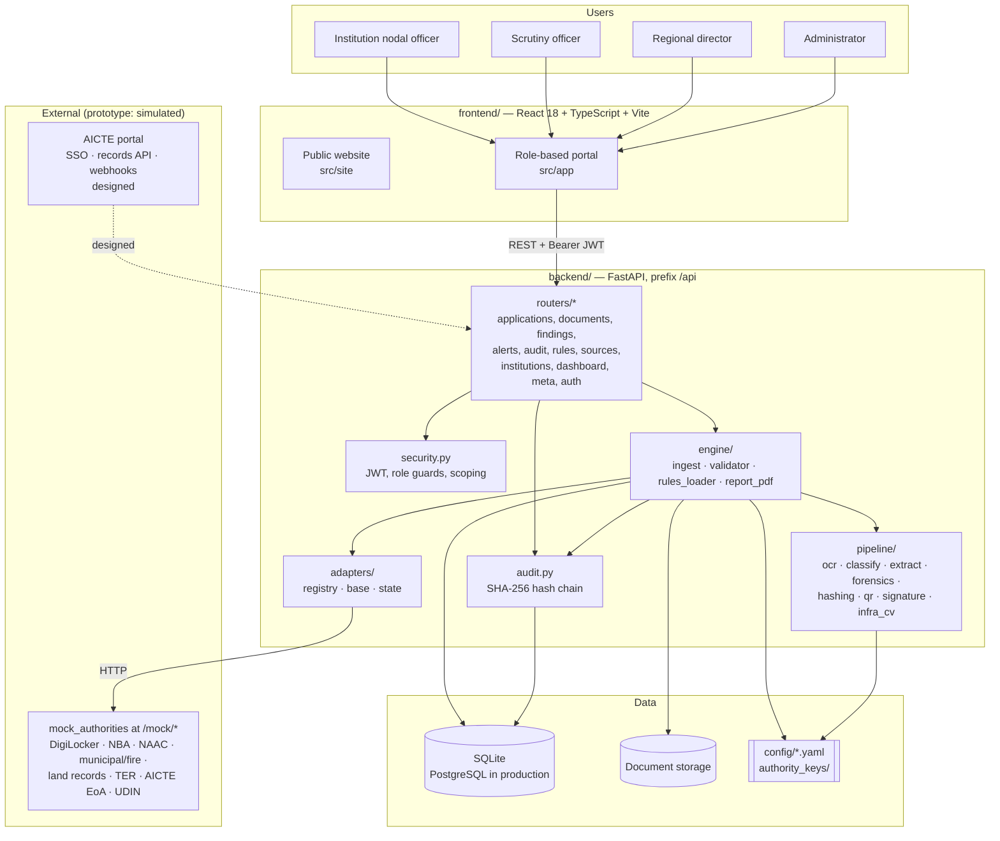
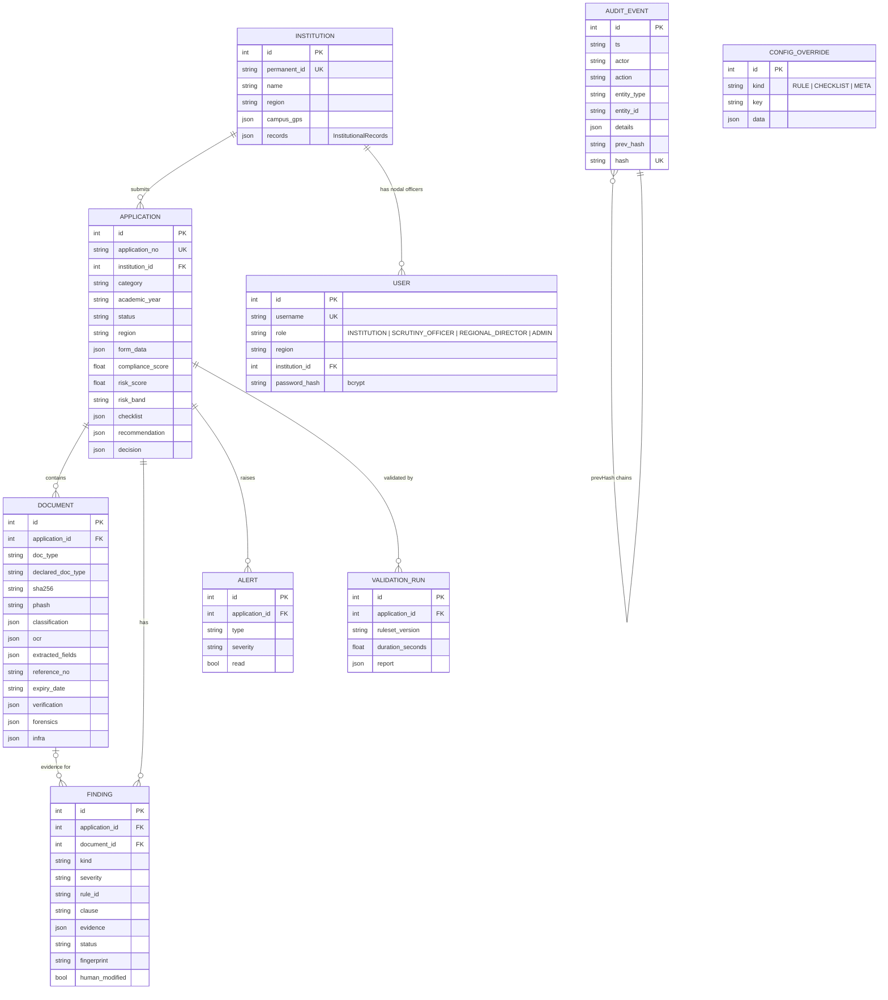
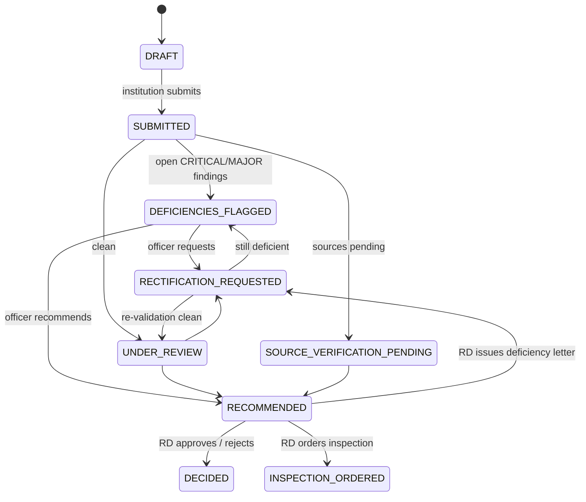

# Architecture

VeriSense is a single FastAPI service with a React front end. The document-AI pipeline is a set of
pure functions, issuing authorities sit behind adapters, and rules and checklists are versioned
configuration. Each part can be tested, replaced or integrated on its own.

## 1. Components



| Component | Path | Responsibility |
|---|---|---|
| Public website | `frontend/src/site` | Explains the solution, PS mapping, evaluation, docs hub |
| Portal | `frontend/src/app` | Dashboards, application workspace, document viewer with extracted fields and ELA, findings, admin console |
| API & access control | `backend/app/routers`, `security.py` | REST endpoints, JWT authentication, role guards, institution/region scoping |
| Ingestion | `backend/app/engine/ingest.py` | Runs the per-document pipeline stage by stage, isolating failures |
| Validator | `backend/app/engine/validator.py` | Evaluates rules, builds checklist, findings, alerts, scores, report |
| Rules loader | `backend/app/engine/rules_loader.py` | Loads YAML baseline, applies admin overrides, computes ruleset version |
| Report PDF | `backend/app/engine/report_pdf.py` | Validation / deficiency report with ReportLab |
| Document AI | `backend/app/pipeline` | Pure functions, no database access |
| Adapters | `backend/app/adapters` | One adapter per issuing authority, six-state verdict |
| Simulated authorities | `backend/app/mock_authorities` | Prototype stand-ins, mounted at `/mock` |
| Audit | `backend/app/audit.py` | Append-only hash-chained log and chain verification |
| Seed | `backend/seed/seed.py` | Users, institutions, records, demo applications run through the real pipeline |

## 2. Sequence: upload → validation → review → decision

```mermaid
sequenceDiagram
  autonumber
  actor I as Institution
  participant P as Portal
  participant A as API
  participant G as Ingest + pipeline
  participant S as Adapter → authority
  participant V as Validator
  participant L as Audit log
  actor O as Scrutiny officer
  actor R as Regional director

  I->>P: Upload Fire NOC (declared FIRE_NOC)
  P->>A: POST /api/applications/{id}/documents
  A->>G: store, sha256 + pHash
  G->>G: OCR → classify → extract fields
  G->>G: forensics (ELA, metadata, fonts)
  G->>G: QR decode → Ed25519 signature check
  G->>S: lookup by referenceNo
  S-->>G: record / 404 / 5xx / timeout
  G->>L: DOCUMENT_UPLOADED (+ verification result)
  A-->>P: Document (fields, forensics, verification state)

  I->>P: Submit
  P->>A: POST /api/applications/{id}/submit
  A->>V: run_validation
  V->>V: checklist · 29 rules · per-document checks
  V->>V: sync findings · scores · status · alerts
  V->>L: VALIDATION_RUN (ruleset version, rules, findings, records checked)
  A-->>P: ValidationReport

  O->>P: Open application from dashboard
  P->>A: GET /api/applications/{id}
  O->>A: PATCH /api/findings/{fid} (acknowledge / dismiss with reason / escalate)
  A->>L: FINDING_UPDATED
  O->>A: POST /request-rectification {note, findingIds}
  A->>L: RECTIFICATION_REQUESTED
  Note over I,A: institution re-uploads → pipeline → officer re-validates
  O->>A: POST /decision {RECOMMEND_ISSUE_DEFICIENCY_LETTER, note}
  A->>L: RECOMMENDATION_RECORDED
  R->>A: POST /decision {ISSUE_DEFICIENCY_LETTER, note}
  A->>A: guard: note required; approval blocked while CRITICAL findings OPEN
  A->>L: DECISION_RECORDED
```

## 3. Data model



Institutional records (previous approvals, approved programmes, faculty, accreditations, land and
building, TER payments, deficiency history, affidavits) are stored as JSON on the institution in
the prototype; in production they would be read from AICTE's systems through the records interface.

## 4. Data flow and state



The validator moves an application only among the automatic statuses (submitted, under
validation, deficiencies flagged, source verification pending, under review, rectification
requested). Statuses created by people (recommended, inspection ordered, decided) are never changed
automatically. The Regional Director may also decide directly from review statuses.

## 5. Integration with the AICTE portal (designed)

VeriSense is meant to sit beside the existing approval portal, not replace it.

| Integration point | Design | Status |
|---|---|---|
| REST API with OpenAPI schema | `GET /openapi.json`, interactive docs at `/docs` | Built |
| Single sign-on | OIDC/SAML from the AICTE identity provider; role and region from token claims replace local passwords | Designed |
| Records API | `InstitutionalRecords` read through one interface; prototype reads seeded JSON, production calls AICTE databases | Prototype-simulated |
| Inbound webhook | Portal notifies VeriSense on submission (application ID, document URIs) | Designed |
| Outbound webhook | VeriSense posts validation summary and, once recorded, the official's decision back to the portal | Designed |
| Issuing-authority APIs | Adapter per source; see [VERIFICATION_SOURCES.md](VERIFICATION_SOURCES.md) | Prototype-simulated |

## 6. Deployment

- **Containerised.** Backend (Python 3.11, uv) and frontend (static build served by any web server)
  build into standard images. No GPU and no external AI service; RapidOCR (ONNX) and OpenCV run on
  CPU.
- **Government cloud ready.** Designed for NIC / MeghRaj: PostgreSQL via `VERISENSE_DB`
  (any SQLAlchemy URL), document storage via `VERISENSE_STORAGE` (mount an encrypted volume or object
  store gateway), secret via `VERISENSE_SECRET`, CORS origins via `VERISENSE_CORS_ORIGINS`.
- **Scaling.** The API is stateless (JWT), so it can run as several replicas behind a load
  balancer. Document processing currently runs synchronously on upload (a few seconds per file on a
  laptop CPU); for bulk intake it would move to a worker queue with the same pure pipeline functions.
- **Audit integrity.** The SQLite prototype enforces append-only audit rows with triggers; on
  PostgreSQL the same would be done with a trigger or row-level security, plus periodic anchoring of
  the chain head outside the database.

## 7. Security model

See [SECURITY_AND_SAFEGUARDS.md](SECURITY_AND_SAFEGUARDS.md) for the RBAC matrix, audit chain,
data protection and human-in-the-loop controls.

## 8. Technology

| Layer | Technology |
|---|---|
| Frontend | React 18, TypeScript, Vite, Tailwind CSS, shadcn/ui (Radix), TanStack Query, Recharts, lucide icons |
| Backend | Python 3.11, FastAPI, Pydantic v2, SQLAlchemy 2, PyJWT, bcrypt, httpx |
| Document AI | PyMuPDF, RapidOCR (ONNX Runtime), rule-based classifier and extractors |
| Forensics | Pillow + NumPy ELA, PDF/EXIF metadata (PyMuPDF, piexif, exifread), imagehash pHash |
| Trust | OpenCV QR decoding, Ed25519 signatures (cryptography) |
| Infrastructure CV | OpenCV heuristic detector; YOLOv8n optional when installed |
| Reporting | ReportLab |
