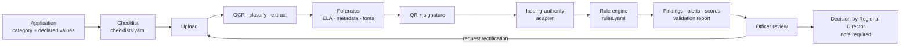

# How VeriSense Works

This document follows an application from creation to decision and describes every check, the
verification states and the scoring formulas. Everything described here is implemented unless
marked otherwise. All outputs are **advisory**: they support the scrutiny officer and never decide.



---

## 1. Application and checklist

An institution creates an application with a **category** (`EOA`, `NEW_INSTITUTION`,
`INTAKE_INCREASE`, `NEW_COURSE`, `CHANGE_OF_NAME`, `CHANGE_OF_SITE`, `CLOSURE`), an academic year
and declared values (`formData`): programmes and intake, total intake, faculty count and cadre,
land and built-up area, location type, TER transaction ID, accreditation claims, faculty list.

The category selects a checklist from `config/checklists.yaml`. Items are mandatory, optional, or
conditional (`when:` evaluated on the declared values, e.g. NBA certificate required only when
`nbaAccredited` is claimed). Each item carries an illustrative APH clause. See
[RULES_AND_CHECKLISTS.md](RULES_AND_CHECKLISTS.md).

Institutions can run validation on a **draft** (pre-check) to find gaps before submitting.

## 2. Institutional records

Records already held by AICTE are attached to the institution and served by
`GET /api/institutions/{id}/records`:

| Record set | Used by |
|---|---|
| `previousApprovals` (year, status, letter ref) | R-REC-001 previous EoA on record |
| `approvedProgrammes` (level, programme, course, shift, intake) | R-REC-002 intake within approved intake, R-THR-001 ratio |
| `faculty` (id, masked PAN, designation, qualification, joining date) | R-REC-003 faculty count, R-CAD-001 cadre, R-DUP-002 duplicate faculty |
| `accreditations` (NBA/NAAC, validity) | R-EXP-002 accreditation validity |
| `landAndBuilding` (land acres, built-up sqm, ownership) | R-REC-004/005 area matches |
| `terPayments` (year, amount, txn, status) | R-TER-001 TER paid |
| `deficiencyHistory` (year, item, status) | R-REC-006 no open deficiencies |
| `affidavits` (year, type, notarised on) | R-EXP-003 affidavit for current year |

In the prototype these are seeded synthetic records standing in for AICTE databases (status:
*prototype-simulated*). The validation report lists which record sets were checked
(`recordsChecked`).

## 3. Document pipeline (runs on every upload)

Implemented in `backend/app/engine/ingest.py`, calling pure functions in `backend/app/pipeline/`.
Each stage is isolated: if one fails, the error is recorded on the document, verification falls
back to `MANUAL_REVIEW_REQUIRED`, and the upload still succeeds.

### 3.1 Store and fingerprint

File stored under `storage/{applicationId}/`; **SHA-256** of the bytes and a **perceptual hash**
(pHash of the image or first PDF page) are computed for duplicate detection.

### 3.2 OCR

`pipeline/ocr.py`: the **PDF text layer** is used where present (PyMuPDF); scanned pages and images
go through **RapidOCR** (ONNX, CPU). Output: full text (pages separated), per-line blocks with
bounding box, page and confidence, method (`pdf-text`, `rapidocr`, `pdf-text+rapidocr`), and an
overall confidence. Lines are reassembled in reading order so table rows and "Label: value" pairs
stay intact.

### 3.3 Classification

`pipeline/classify.py`: an explainable classifier with weighted keyword/regex evidence per document
type plus filename hints. Each pattern counts once; confidence combines evidence strength with the
margin over the runner-up. Output includes human-readable **signals** (why this type).

If the institution declared one type and the classifier predicts a different one with confidence
**> 0.7**, an `INCONSISTENCY` finding is raised ("Uploaded as X but content looks like Y").

### 3.4 Field extraction

`pipeline/extract.py`: per-type rules extract fields such as `referenceNo`, `issuer`,
`institutionName`, `issueDate`, `expiryDate`, amounts, areas, intake, survey number, grade, UDIN,
transaction ID and faculty count. Indian date formats are normalised to ISO; Indian digit grouping
and Rs./INR/₹ are understood; hectares are converted to acres. Every field has `value`,
`confidence`, `sourceText` (the exact text it came from) and `page`, which become evidence in
findings. Where a type has a standard validity (`doc_types.yaml` `validityMonths`) and no printed
expiry, an expiry is derived from the issue date and marked as derived.

### 3.5 Forensics (preliminary tamper indicators)

`pipeline/forensics.py`. Every flag says it is a preliminary indicator, not proof.

| Check | Flag code | Severity |
|---|---|---|
| Error Level Analysis: JPEG re-save at quality 90, block-wise difference normalised by local edge energy; spatially clustered outlier blocks reported with a bounding box and heatmap | `ELA_LOCALISED_ANOMALY` | MAJOR |
| PDF Producer/Creator names an editor (Photoshop, Canva, PDF editors ...) | `PDF_EDITING_SOFTWARE` | MAJOR (online converters MINOR) |
| PDF modification date differs from creation date | `PDF_MODIFIED_AFTER_CREATION` | MINOR |
| Incremental updates (multiple `%%EOF` / `startxref` sections) | `PDF_INCREMENTAL_UPDATE` | MINOR/MAJOR |
| A rarely used font inside a single line of the text layer | `FONT_INCONSISTENCY` | MAJOR |
| Overlapping text spans with different content (text pasted over text) | `TEXT_OVERLAY` | MAJOR |
| EXIF Software tag names an image editor | `IMAGE_EDITING_SOFTWARE` | MAJOR |
| EXIF modified time differs from original capture time | `IMAGE_MODIFIED_AFTER_CAPTURE` | MINOR |

ELA runs on images and on raster images embedded in PDFs (scanned pages). The heatmap is available
to officers at `GET /api/documents/{id}/ela`.

### 3.6 Signed QR

`pipeline/qr.py` renders pages and decodes QR codes (OpenCV); `pipeline/signature.py` verifies
Ed25519-signed payloads against issuer public keys and the claims are compared with the printed
values. See [VERIFICATION_SOURCES.md](VERIFICATION_SOURCES.md).

### 3.7 Issuing-authority verification

The adapter registered for the document type looks it up by reference number. The result is one of
the six states below, stored with source, method, timestamp, response summary and field-by-field
comparisons.

### 3.8 Infrastructure evidence

`pipeline/infra_cv.py` analyses photographs of classrooms, computer labs, libraries, laboratories
and accessibility features:

- **Object detection and counts.** A deterministic OpenCV detector runs by default (monitor-like
  rectangles, desk tops, book-spine strips, bench tops, extinguishers, handrails) and reports
  `method: "heuristic"` with low confidence. If the Ultralytics package and YOLOv8n weights are
  installed, YOLOv8n is used instead (`method: "yolov8n"`). It is never auto-installed.
- **Quality:** blur (variance of Laplacian), brightness, resolution.
- **EXIF:** capture date, GPS, device, software.
- **Flags:** `EXPECTED_OBJECTS_NOT_DETECTED`, `LOW_QUALITY_BLUR`, `POOR_LIGHTING`,
  `LOW_RESOLUTION`, `EXIF_MISSING`, `GPS_MISSING`, `GPS_FAR_FROM_CAMPUS`, `PHOTO_TOO_OLD`,
  `PHOTO_DATE_IN_FUTURE`, `PHOTO_EDITED`.

Counts are assistive estimates that tell the officer where a physical inspection may be warranted;
they are not an inspection. Reused or stock photos are caught by the application-level duplicate
rule (SHA-256 / pHash). Video and floor-plan image analysis are roadmap items.

## 4. Verification states

| State | Meaning | Typical cause |
|---|---|---|
| `VERIFIED` | Source record or valid signed QR confirms the document | All compared fields match, status valid |
| `MISMATCH_DETECTED` | Source disagrees with the submission | Field differs, record revoked, signature invalid, confident reference not found |
| `EXPIRED` | No longer valid | Printed or source validity in the past, source status EXPIRED |
| `VERIFICATION_PENDING` | Check queued or not complete | Source answered 202, or read timeout |
| `SOURCE_UNAVAILABLE` | Source could not be reached | Source switched off, 5xx, connection refused |
| `MANUAL_REVIEW_REQUIRED` | No automatic conclusion | No source for the type, reference not readable, low-confidence not-found, pipeline error |
| `NOT_APPLICABLE` | Not an issued document | Faculty rosters, infrastructure photographs |

Full decision table: [VERIFICATION_SOURCES.md § 3](VERIFICATION_SOURCES.md#3-decision-logic-six-states).

## 5. Rule engine (runs on submit and on demand)

`backend/app/engine/validator.py` → `run_validation(application_id)`:

1. Build the checklist with live statuses (`PRESENT`, `MISSING`, `EXPIRED`, `INVALID`,
   `NOT_REQUIRED`).
2. Evaluate every rule in `rules.yaml` (with admin overrides). Disabled rules and rules not
   applicable to the category are recorded as `SKIPPED`; a rule that errors is `SKIPPED` with the
   error and never aborts the run.
3. Add per-document findings (classification mismatch, pipeline errors, infrastructure flags).
4. Synchronise findings idempotently: untouched `OPEN` findings are regenerated; findings a human has
   acted on are kept.
5. Compute scores and move the application status (`DEFICIENCIES_FLAGGED` if any open critical/major
   finding, else `SOURCE_VERIFICATION_PENDING` if sources are pending, else `UNDER_REVIEW`).
   Statuses that represent a human step (inspection ordered, recommended, decided) are never changed.
6. Raise alerts.
7. Store a `ValidationRun` with the full report and write a `VALIDATION_RUN` audit event (ruleset
   version, duration, pass/fail/skip counts, failed rule IDs, findings created/removed/kept, records
   and documents checked, status change, alerts).

### Findings

Every finding has `kind` (`MISSING_DOCUMENT`, `MISSING_FIELD`, `EXPIRED_DOCUMENT`,
`INCONSISTENCY`, `RECORD_MISMATCH`, `ANOMALY`, `DUPLICATE`, `VERIFICATION`, `COMPLIANCE_GAP`,
`INFRASTRUCTURE`), `severity`, `title`, `reason`, `ruleId`, `clause`, typed `evidence[]` (document
field with page and source text, form value, AICTE record value, source response, image region,
metadata, and the rule itself with its version) and `advisory: true`.

Example (shape produced by R-EXP-001 for an expired Fire NOC; values illustrative):

```json
{
  "kind": "EXPIRED_DOCUMENT",
  "severity": "CRITICAL",
  "title": "Fire Safety No Objection Certificate expired on 2026-10-10",
  "reason": "Fire Safety No Objection Certificate validity ended 16 day(s) before the scrutiny date 2026-10-26.",
  "ruleId": "R-EXP-001",
  "clause": "APH 2024-27 (illustrative) — Ch. III, Safety norms: valid Fire NOC",
  "evidence": [
    {"type": "FIELD", "label": "Fire Safety No Objection Certificate — fire_noc.pdf", "page": 1,
     "excerpt": "Valid upto: 10/10/2026", "submitted": "2026-10-10"},
    {"type": "RULE", "label": "Scrutiny date", "reference": "2026-10-26"},
    {"type": "RULE", "label": "R-EXP-001 v1 — Fire NOC valid"}
  ],
  "advisory": true
}
```

### Alerts

| Alert | Severity | When |
|---|---|---|
| `MISSING_DOCUMENTS` | MAJOR | Mandatory checklist items missing |
| `DOCUMENT_EXPIRED` | CRITICAL | Any checklist item expired |
| `SUSPECTED_ANOMALY` | CRITICAL | Open critical/major anomaly or verification finding |
| `DUPLICATE_DETECTED` | CRITICAL | Cross-institution duplicate document or faculty |
| `SOURCE_UNAVAILABLE` | MINOR | A source could not be reached |
| `SOURCE_VERIFICATION_PENDING` | INFO | Documents awaiting source verification |

Alerts are created in the same transaction as the findings, so they are visible as soon as
validation completes. Identical unread alerts are not duplicated.

## 6. Scoring

### Compliance score (0–100)

```text
compliance = 100 × Σ_r  w(sev_r) × (1 − failed_r / checks_r)
                   ─────────────────────────────────────────
                         Σ_r  w(sev_r)
```

over every rule `r` that was not skipped. `w` is `severityWeights` in `rules.yaml` (CRITICAL 5,
MAJOR 3, MINOR 1, INFO 0). A rule with no individual checks counts 1 if it passed, 0 if it failed.
If no rule ran, the score is 100.

### Risk score (0–100) and band

```text
Only OPEN, ACKNOWLEDGED and ESCALATED findings contribute.
Group points(severity) × mult(kind) by (kind, severity).
For each group: contribution = min(2 × peak, peak + 0.25 × (sum − peak)).
All MINOR contributions combined are capped at 15.
risk = min(100, substantive contributions + capped minor contributions).
An open CRITICAL VERIFICATION, ANOMALY, DUPLICATE or RECORD_MISMATCH sets a floor of 60.
```

| Severity | points |
|---|---|
| CRITICAL | 30 |
| MAJOR | 15 |
| MINOR | 5 |
| INFO | 0 |

| Kind | mult |
|---|---|
| ANOMALY, DUPLICATE, VERIFICATION | 1.0 |
| RECORD_MISMATCH, INCONSISTENCY | 0.8 |
| EXPIRED_DOCUMENT, COMPLIANCE_GAP | 0.5 |
| MISSING_DOCUMENT, INFRASTRUCTURE | 0.4 |
| MISSING_FIELD | 0.3 |

Band: **LOW** < 30 ≤ **MEDIUM** < 60 ≤ **HIGH**.

These are illustrative queue-prioritisation thresholds, not a statistically calibrated probability.
A single missing document still creates its critical finding and blocks approval where applicable;
it does not by itself imply fraud. Repeated low-level indicators cannot overwhelm a clean application.
Perceptual hashes require matching reference/text before flagging near-duplicates. Identifiable
original owners (institution name or campus GPS) are not penalised when their evidence is reused elsewhere.

Compliance measures *how much of the rulebook is satisfied*; risk measures *how much integrity
concern is open*. Dismissed and rectified findings stop counting. Both are for prioritising the
queue — neither decides an application.

## 7. Officer review, rectification and decision

| Actor | Actions |
|---|---|
| Scrutiny officer | Re-run validation and source verification; acknowledge, dismiss or escalate findings with notes; add observations; request rectification for selected findings; record a recommendation |
| Institution | Upload corrected documents; mark findings acknowledged or rectified with a note |
| Regional Director | Record the decision: `APPROVE_FOR_EOA`, `ISSUE_DEFICIENCY_LETTER`, `ORDER_INSPECTION`, `REJECT` — a note is mandatory |

The rectification loop: officer requests rectification (status `RECTIFICATION_REQUESTED`,
institution alerted) → institution uploads and marks findings rectified → pipeline runs on the new
files → officer re-runs validation → officer closes or escalates. Every step is in the audit chain.

The validation report (`GET /api/applications/{id}/report`, PDF at `/report.pdf`) contains the
summary, checklist, all findings with evidence, verification results, every rule applied with its
result, the records checked, the ruleset version and an advisory disclaimer.
